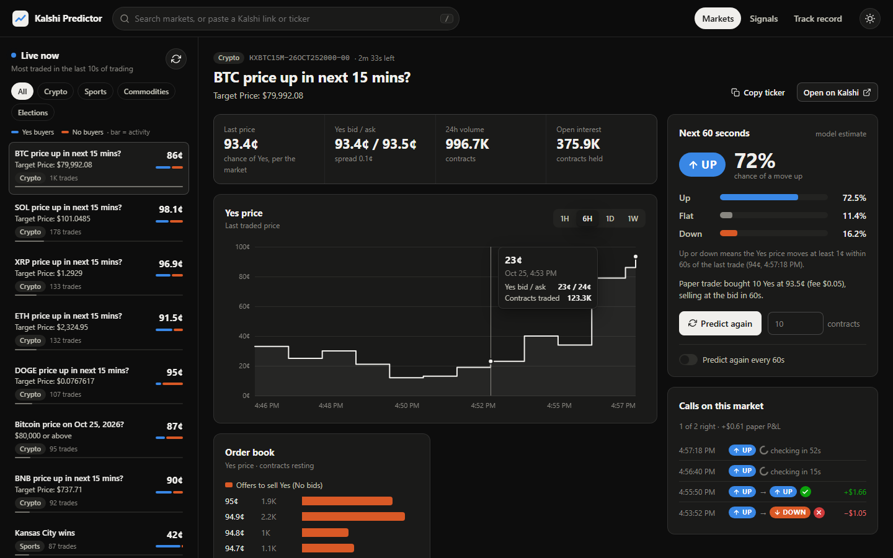
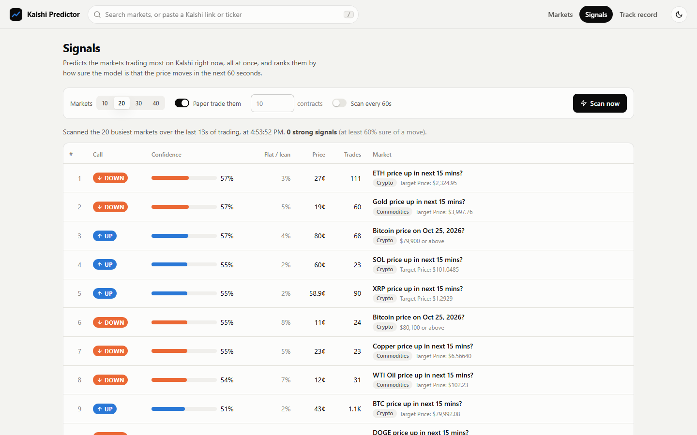
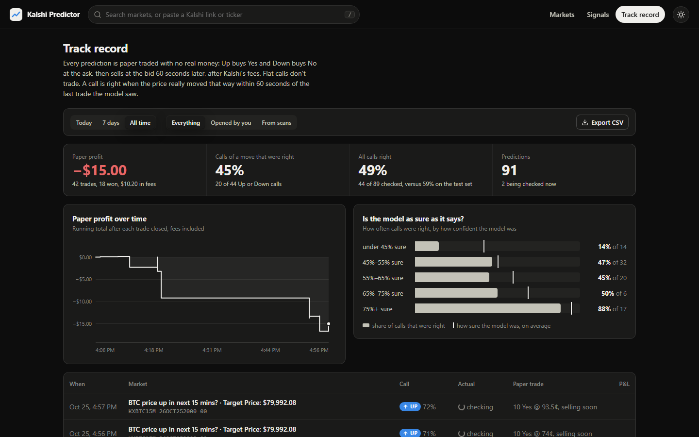

# Kalshi Price Predictor

[](https://github.com/zaindahdul/TensorflowModel/actions/workflows/tests.yml)

A TensorFlow model that reads a Kalshi market's last 50 trades and predicts
whether its Yes price will go **up**, go **down** or stay **flat** over the
next 60 seconds, plus a live dashboard that finds markets for you, paper
trades every prediction, and keeps an honest track record.



## What the dashboard does

- **Live now:** a sidebar of the markets trading most on Kalshi in the last
  few seconds, refreshed every 10s. Those are the markets the model reads
  best, and one click opens them. You never need to look up a ticker.
- **Search by name:** type `packers`, `bitcoin` or `fed` and pick from the
  matching open events. Pasting a kalshi.com link or a ticker works too,
  in the search box or anywhere on the page.
- **Bookmarklet:** drag *Predict on dashboard* from the welcome page to your
  bookmarks bar, then click it on any kalshi.com page to open that market here.
- **Market page:** quotes, a price chart (1h to 1w) with a crosshair, the
  order book, the other markets in the event, the resolution rules, the
  model's prediction, and how its past calls on that market turned out.
  It can re-predict every 60 seconds by itself.
- **Signals:** predicts the 10 to 40 busiest markets at once and ranks
  them by the model's confidence.
- **Track record:** paper profit over time, how often calls were right,
  whether the model is as sure as it claims (calibration), and every
  prediction in a table you can export as CSV.

| Signals | Track record |
| --- | --- |
|  |  |

## Quick start

Python 3.10 or newer:

```sh
python -m venv .venv
.venv\Scripts\activate            # macOS/Linux: source .venv/bin/activate
pip install -r requirements.txt
python -m kalshi_predictor        # opens the dashboard at http://127.0.0.1:8765
```

On Windows you can also double-click `dashboard.cmd`, or run `p.cmd <ticker>`
for a quick prediction in the terminal. No Kalshi account or API key is needed.

## Commands

```sh
python -m kalshi_predictor dashboard              # the web dashboard (default)
python -m kalshi_predictor predict KXBTC15M       # a market, event, series or kalshi.com link
python -m kalshi_predictor scan --markets 30      # rank the busiest live markets
python -m kalshi_predictor fetch --markets 400    # download trade history to train on
python -m kalshi_predictor train                  # train and evaluate the model
```

A series ticker such as `KXBTC15M` resolves to whichever of its events is
open and closes next, so recurring markets never need a fresh ID. Text that
isn't a ticker is treated as a search.

## How the model works

Each sample is a window of a market's last 50 trade events (fills from one
order merged into one event) with 8 features per event: price, price
relative to the latest, price change, taker side, size, signed size, time
since the previous trade and time to close. The label is whether the last
traded price 60 seconds later moved by at least 1¢ (up / down) or not (flat).

The model is a Conv1D layer feeding a GRU. It is evaluated on the most
recent markets, which it never saw in training, with a one-horizon gap
between the splits so no label leaks across them.

| Test set (28,332 samples) | Accuracy | Macro F1 |
| --- | --- | --- |
| Always guess the most common class | 38.2% | 0.18 |
| Logistic regression on the last trade | 52.6% | 0.51 |
| **Conv1D + GRU over 50 trades** | **59.1%** | **0.60** |

## Paper trading

Every prediction the dashboard makes is paper traded with no real money.
Up buys Yes and Down buys No at the ask when you predict, and the position
is sold at the bid 60 seconds later (or settles if the market resolves
first), after Kalshi's taker fee of `0.07 × C × P × (1 − P)` rounded up to
the cent. Flat calls don't trade. It assumes your whole order fills at the
best price.

Beating the coin flip is not the same as making money: on cheap one-minute
trades the fees and the spread take a large share of each win, and the
track record shows exactly how much. History is stored locally in
`data/prediction_history.json`.

## Project layout

```
kalshi_predictor/
  kalshi.py       Kalshi API client: trades, search, live activity, order books, candles
  dataset.py      trades -> model windows and labels, chronological splits
  train.py        model definition, baselines, training and evaluation
  predict.py      fetch a market's latest trades and run the model (batched)
  scan.py         rank the busiest live markets by model confidence
  tracker.py      paper trading, outcome checks, track record, CSV export
  dashboard.py    local web server and JSON API
  static/         the dashboard front end (plain ES modules, no build step)
tests/            pytest suite; runs without TensorFlow
artifacts/        the trained model and its metrics
data/             downloaded trades and markets
```

Run the tests with `python -m pytest`.

## Notes

- Market data comes from Kalshi's public API. Search uses the same endpoint
  as kalshi.com's search box, which is not part of the documented API and
  could change.
- The dashboard only listens on 127.0.0.1, so only this computer can reach it.
- These are estimates from a statistical model, not financial advice.
